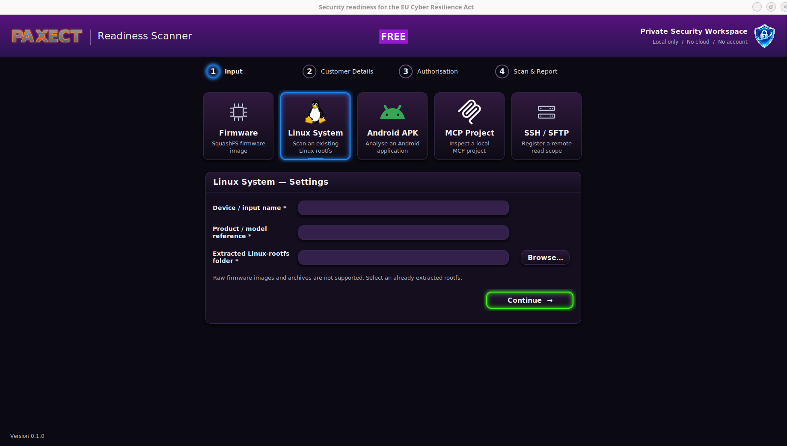
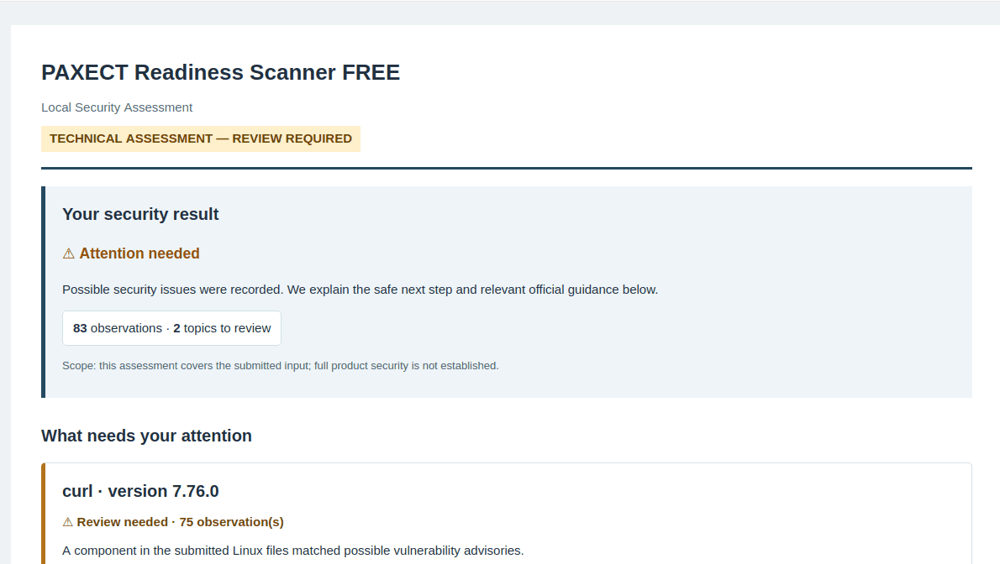
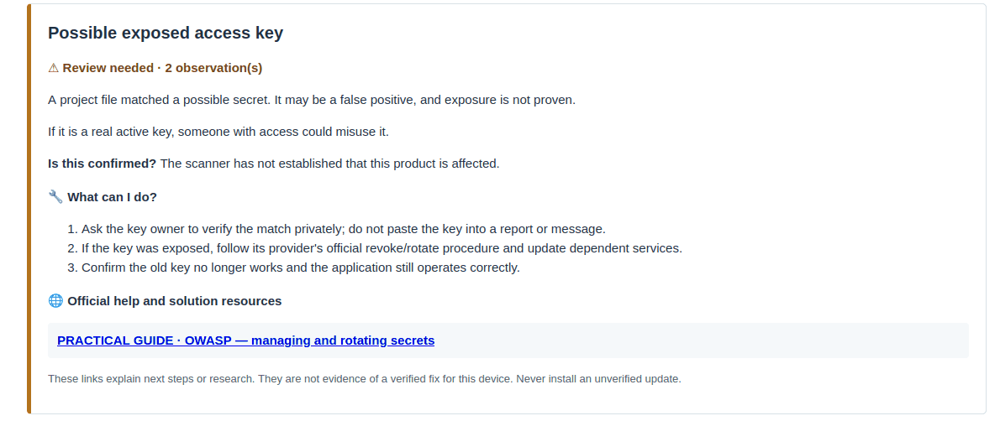
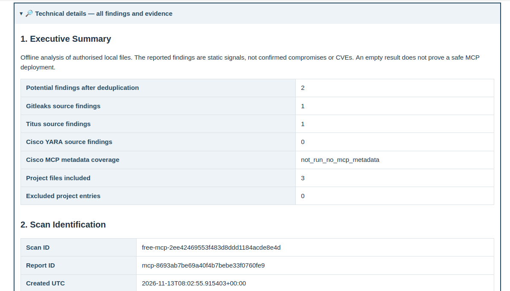
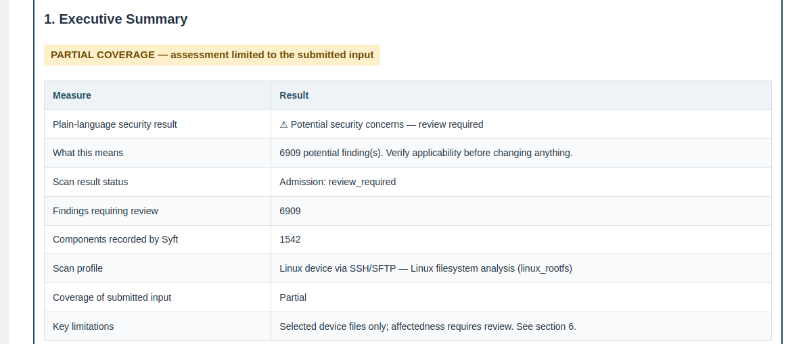

<p align="center">
  
</p>

<h1 align="center">PAXECT CRA Readiness Scanner FREE</h1>

<p align="center"><b>Free local readiness scanner for the EU Cyber Resilience Act (CRA).</b></p>

<p align="center">No account &nbsp;·&nbsp; No cloud &nbsp;·&nbsp; No telemetry</p>

<p align="center">
  <a href="https://github.com/PAXECT-Interface/paxect-cra-readiness-scanner/releases/latest"><b>Download the latest release</b></a>
  &nbsp;·&nbsp; <a href="#install">Install and verify</a>
  &nbsp;·&nbsp; <a href="#install-with-an-ai-assistant">Install with an AI assistant</a>
  &nbsp;·&nbsp; <a href="SECURITY.md">Security policy</a>
</p>

<p align="center">
  
</p>

## In short

PAXECT CRA Readiness Scanner FREE is a free program for Ubuntu. You give it a product — firmware, a Linux system, an Android app or an MCP project — and it creates a clear report that shows possible security weaknesses and the evidence behind them.

- **Free to use.** No account, no sign-up.
- **Runs on your own computer.** Your scan input is not uploaded anywhere.
- **One report per scan**, which you can save, share and archive.
- **Helps you prepare for the EU Cyber Resilience Act.** It does not certify your product.

> **Free to use, not open source.** PAXECT FREE is distributed free of charge as an Ubuntu package with a signed checksum file, under the [PAXECT FREE License Agreement](LICENSE.md). This repository contains documentation and release files only; the source code of PAXECT itself is not published. The bundled open-source components keep their own licenses — see [THIRD_PARTY_NOTICES.md](THIRD_PARTY_NOTICES.md).

## Who is it for?

Manufacturers, developers and security teams who make products with digital elements and want to see where their product stands ahead of the main obligations of the CRA, which apply from 11 December 2027. You do not need to be a security expert to read the report: findings come with explanations and guidance where available.

## How it works

1. **Install** the package on Ubuntu 24.04 (see [Install](#install)).
2. **Open PAXECT FREE** and choose what you want to scan.
3. **Select your input** (a file, a folder, an APK, a project or a device) and confirm that you are allowed to scan it.
4. **Start the scan.** You see the progress live. When it is finished, you get the report. Save it wherever you want, or start a new scan.

## What you can scan

| Input | What PAXECT FREE does |
| --- | --- |
| **Firmware file** | Opens the SquashFS file system in an isolated sandbox, lists the software components inside (an SBOM) and matches them against known vulnerabilities. |
| **Linux system (folder)** | Scans an extracted Linux root file system. |
| **Linux system (SSH / SFTP)** | Reads only explicitly allowed files from a device you are authorised to access, with read-only access, checks the device against a `known_hosts` file you provide, and scans them locally. |
| **Android APK** | Checks the manifest, signatures, security settings and bundled components. |
| **MCP project** | Static security analysis of a Model Context Protocol server project, including secret detection. Project code is not executed. |

How much a scan can find depends on the input. Each report states what was and was not covered.

## What you get: the report

Every scan produces one HTML report that you can open in any browser. It is written to be read by people, not only by tools. The contents vary by input type; a report can include:

- **Your security result** — a short summary first, with the scope stated.
- **What needs your attention** — the findings, one by one, with an explanation of what each means.
- **What can I do?** — concrete next steps and links to official guidance.
- **Technical details and evidence** — the underlying data, so you can check every finding yourself.
- **Scan identification** — a Scan ID, a Report ID and the time the report was created, so you can trace it later.
- **Scope and limitations** — what the scan covered, and what it did not.
- **CRA next steps** — links to official CRA guidance.

Findings are signals that need review. They are not proof that your product is vulnerable.

### Example reports

Sample reports from test inputs, not assessments of real products. Click an image to enlarge it.

<table>
  <tr>
    <td width="50%" valign="top">
      <a href="docs/images/report-01-result.png"></a>
      <br><sub><b>A plain-language result comes first,</b> with the scope stated. (Linux test input)</sub>
    </td>
    <td width="50%" valign="top">
      <a href="docs/images/report-02-finding.png"></a>
      <br><sub><b>Each finding explains what it means</b> and what you can do next. (test project with a fake token)</sub>
    </td>
  </tr>
  <tr>
    <td width="50%" valign="top">
      <a href="docs/images/report-03-traceability.png"></a>
      <br><sub><b>Every report carries a Scan ID, a Report ID</b> and the time it was created. (test project)</sub>
    </td>
    <td width="50%" valign="top">
      <a href="docs/images/report-04-coverage.png"></a>
      <br><sub><b>Coverage and key limitations are stated up front.</b> (SSH / SFTP test device)</sub>
    </td>
  </tr>
</table>

## Requirements

- **Ubuntu 24.04 LTS** (desktop), 64-bit (amd64)
- Internet access for installation and for downloading the public vulnerability databases
- Other Ubuntu versions and distributions are not supported in this release

## Install

Download these four files from the [latest release](../../releases/latest) into one folder:

- `paxect-free_0.1.0_amd64.deb`
- `SHA256SUMS`
- `SHA256SUMS.asc`
- `PAXECT_RELEASE_SIGNING_KEY.asc`

In the Files app, open the folder with the four files, right-click an empty area and choose **Open in Terminal**. Then run the steps below. They help you verify the release signature and check that the package has not been changed, so please do not skip them. For extra assurance, confirm the signing key fingerprint through an independent PAXECT channel (see About below):

```bash
# 1. Import the PAXECT release signing key and show its fingerprint
gpg --import PAXECT_RELEASE_SIGNING_KEY.asc
gpg --fingerprint PAXECT-Team@outlook.com
```

**Check that the fingerprint is exactly:**

```
F914 7E2E C87B B514 BCA5  D9F7 0C18 1E6D 1CFD B2A9
```

Stop if it differs.

```bash
# 2. Verify the signature and the package checksum
gpg --verify SHA256SUMS.asc SHA256SUMS      # must say: Good signature from "PAXECT Release Signing"
sha256sum -c SHA256SUMS                     # must say: paxect-free_0.1.0_amd64.deb: OK
```

gpg may also warn that the key is not certified with a trusted signature. That is normal for a newly imported key. The signature only counts if the fingerprint in step 1 matched: that check confirms the key is the one PAXECT published here. Because the fingerprint is published in the same place as the key, you can also confirm it with PAXECT through a second channel (see About below).

```bash
# 3. Install (apt also installs the required Ubuntu packages)
sudo apt update
sudo apt install ./paxect-free_0.1.0_amd64.deb
```

Start **PAXECT FREE** from the application menu, or run `paxect-free` in a terminal.

The first scan also downloads the vulnerability databases and can take a few minutes. Later scans are faster.

## Install with an AI assistant

You can follow the [Install](#install) steps on your own. You can also do them together with an AI assistant. Either way, you stay in control: **you** run the commands, **you** read the output, and **you** decide whether to continue.

### Two routes

**On your own.** Follow [Install](#install) from top to bottom. After every command, compare what you see with what the step says it must show. If it differs, stop.

**With an AI assistant.** Give the assistant this page and let it guide you step by step. It cannot download, verify or install anything for you unless you have explicitly given it that ability. Copy the output of each command back to the assistant before you go to the next step.

You can start with this message:

```
I want to install PAXECT CRA Readiness Scanner FREE 0.1.0 on Ubuntu 24.04.
Here is the README: <paste this page or its link>.
Guide me through the Install section one command at a time.
After each command I will paste the output. Do not let me continue
if the output does not match what the README says it must show.
```

### What the assistant should check

1. **Your system, before anything is downloaded.** Ubuntu 24.04 LTS, 64-bit (amd64). Check with `lsb_release -d` and `dpkg --print-architecture`. Other versions are not supported in this release. If yours differs, stop.
2. **Your folder.** The terminal must be open in the folder that holds the four release files. Check with `ls`: all four files must be listed.
3. **The fingerprint.** The output of `gpg --fingerprint` must match the fingerprint printed in this README exactly, character by character. The assistant must compare it itself and must not assume it is correct.
4. **The signature.** `gpg --verify` must say `Good signature`. The warning that the key is "not certified with a trusted signature" is expected. It does not replace the fingerprint check.
5. **The checksum.** `sha256sum -c SHA256SUMS` must show `paxect-free_0.1.0_amd64.deb: OK`.
6. **The install.** Only the two `sudo` commands in step 3 of [Install](#install) (`apt update` and `apt install`) need administrator rights. Read what apt wants to install before you confirm. If apt reports errors or unmet dependencies, stop and report them.
7. **Only the documented commands.** The assistant should use only the commands in the Install section. If something goes wrong, it must first explain the error. It must not suggest other downloads, changed security settings or a different source for the files.

### Stop and do not install if

- the fingerprint differs in any character;
- `gpg --verify` does not say `Good signature`;
- `sha256sum -c` does not say `OK`;
- the files did not come from the [official release page](https://github.com/PAXECT-Interface/paxect-cra-readiness-scanner/releases/latest);
- you are asked to turn off a security check, to run a command you do not understand, or to enter a password anywhere other than the `sudo` prompt.

### What an assistant can and cannot tell you

- A matching signature and checksum show that the files are the ones published with this key, provided the key is authentic. They do not prove that any piece of software is free of faults.
- Whether to trust PAXECT is your decision. An assistant can explain the steps and what each result means. It cannot guarantee that the software is safe, and different assistants may judge it differently.
- Do not share passwords, recovery keys or private files with an assistant. The install steps do not need them.
- If something looks wrong, ask the assistant to stop, and contact PAXECT (see [About](#about)) or report it as described in [SECURITY.md](SECURITY.md).

## Update

Download the new release files and verify them as above. Then install the new package; replace `VERSION` with the version in the file name you downloaded (for example `0.1.1`):

```bash
sudo apt update
sudo apt install ./paxect-free_VERSION_amd64.deb
```

Your earlier reports are kept.

## Uninstall

```bash
sudo apt remove paxect-free
```

Your reports and downloaded databases stay in `~/.local/share/paxect-free/`. Delete that folder yourself if you no longer need them. Reports you saved to another location are not affected.

## Privacy and security

- **Local only.** There is no account, no cloud service and no telemetry from PAXECT. Scan input is not uploaded anywhere.
- **Sandboxed analysis.** The bundled scanners run in a [bubblewrap](https://github.com/containers/bubblewrap) sandbox: no network access during analysis and the scan input is mounted read-only.
- **Network use.** Network access is only used to download public vulnerability databases (Trivy from `mirror.gcr.io`, Grype from `grype.anchore.io`) and, for the SSH / SFTP input type, to read the device you choose to scan. Nothing from your scan input is sent. Measured details are in [THIRD_PARTY_NOTICES.md](THIRD_PARTY_NOTICES.md), section 6.
- **Signed releases.** The checksum file (`SHA256SUMS`) of every release is signed with the PAXECT release key (fingerprint above); it covers the package checksum.
- **Verified components.** The bundled scanner binaries were verified against their official upstream releases.

To report a security issue, see [SECURITY.md](SECURITY.md).

## Limitations

- **Readiness, not certification.** PAXECT FREE shows technical findings that are relevant for CRA readiness. It does **not** certify a product, does not make a product compliant, and is not legal advice. Conformity assessment under the CRA remains the responsibility of the manufacturer.
- Findings come from automated tools and public databases. They can contain false positives and cannot find every issue.
- Firmware support in this release: images that contain a SquashFS file system.
- MCP projects: static analysis of project files, including secret detection. Project code is not executed. No SBOM or CVE assessment is performed for MCP projects.
- Some scan and report IDs (for example in Linux and SSH / SFTP reports) start with "cloud-". This is a naming prefix only. Scans run locally on your computer. The only network connections are the downloads of public vulnerability databases and, for SSH / SFTP scans, the connection to the device you specify. The prefix is planned to be replaced in a future update.
- Only scan products and systems you own or are authorised to test.

## Frequently asked questions

**What is the EU Cyber Resilience Act (CRA)?**
Regulation (EU) 2024/2847 sets cybersecurity requirements for products with digital elements sold in the EU. Reporting obligations for actively exploited vulnerabilities apply from 11 September 2026; the main obligations apply from 11 December 2027.

**Is there a free Cyber Resilience Act (CRA) readiness scanner that runs locally?**
Yes — PAXECT CRA Readiness Scanner FREE runs entirely on your own Ubuntu computer, without an account or cloud upload.

**Does PAXECT FREE create an SBOM?**
Yes, where the input type allows it. For firmware images, PAXECT FREE builds a software bill of materials (SBOM) of the scanned product and uses it to find known vulnerabilities; the report shows both. Reports for other input types contain the findings that apply to them, for example static security analysis and secret detection for MCP projects.

**Does PAXECT FREE make my product compliant with the Cyber Resilience Act?**
No. It is a readiness tool: it helps you find and document technical issues early. Compliance requires a full conformity assessment.

**Does it work on Windows or macOS?**
Not in this release. PAXECT FREE 0.1.0 supports Ubuntu 24.04 LTS (amd64) only.

**Do I need an internet connection?**
For installation and for downloading the public vulnerability databases, yes. Your scan input itself is not uploaded.

**Is the source code available?**
No. PAXECT FREE is free to use but not open source. This repository contains documentation and release files only.

**Can I use PAXECT FREE in my business?**
Yes. You may use it free of charge for private and business purposes, including assessments for your own customers. Selling, redistributing or offering it as a hosted service requires written permission. See the [PAXECT FREE License Agreement](LICENSE.md).

## About

PAXECT CRA Readiness Scanner FREE is made by **Vincent Simon (PAXECT Lab)**, the Netherlands.

- Website: [paxect.eu](https://paxect.eu)
- LinkedIn: [linkedin.com/in/vincent-simon-paxect](https://www.linkedin.com/in/vincent-simon-paxect)
- E-mail: PAXECT-Team@outlook.com

Product and company names mentioned here are the property of their respective owners.
